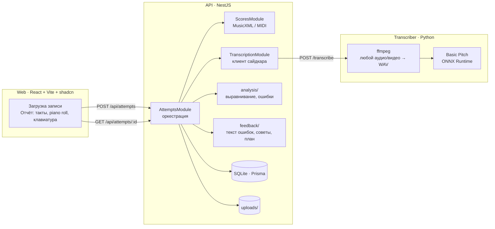
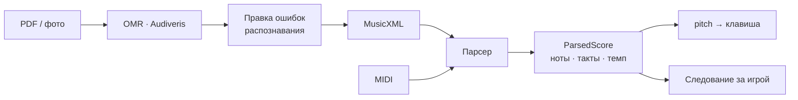
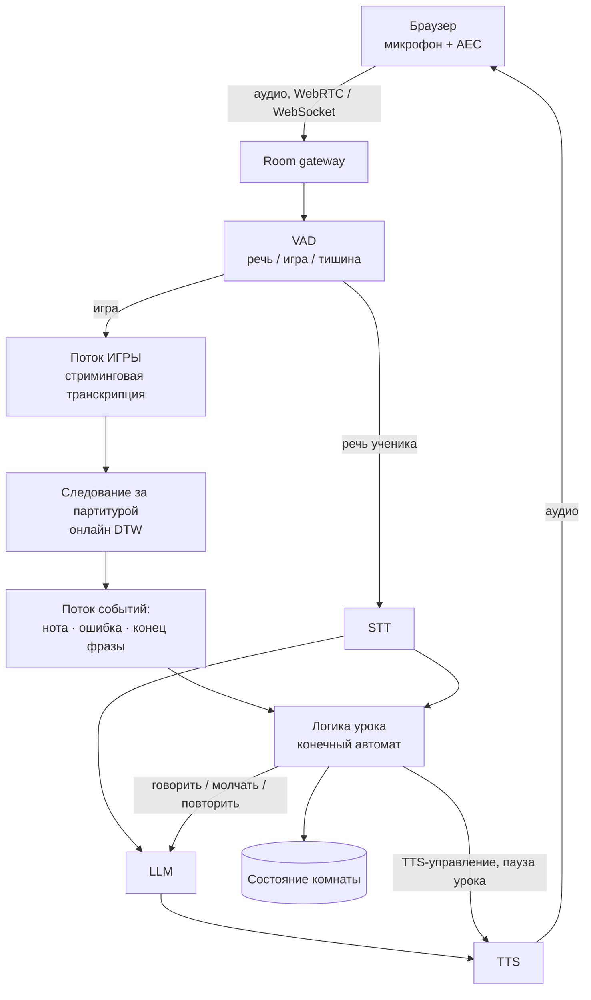
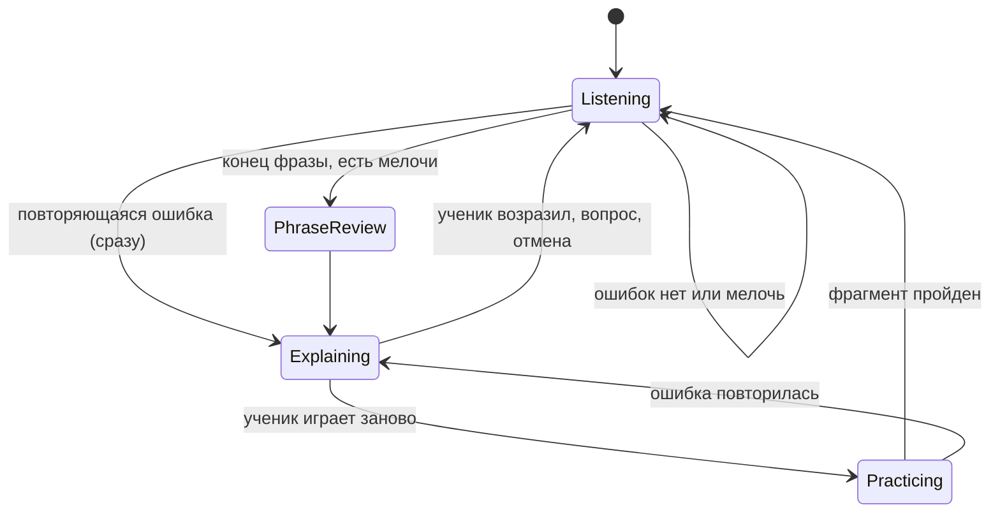

# Архитектура

Документ отвечает на три вопроса из задания и честно разделяет, что **реализовано в демо**, а что **описано как целевой дизайн**.

- [Обзор системы](#обзор-системы)
- [1. Сравнение исполнения с оригиналом](#1-сравнение-исполнения-с-оригиналом)
- [2. Обработка нот пользователя и подсветка клавиш](#2-обработка-нот-пользователя-и-подсветка-клавиш)
- [3. Live AI lesson rooms (audio only)](#3-live-ai-lesson-rooms-audio-only)
- [Ключевые решения и компромиссы](#ключевые-решения-и-компромиссы)
- [Известные ограничения](#известные-ограничения)

## Обзор системы

Поток одной попытки:

1. Пользователь выбирает произведение и загружает запись (аудио или видео).
2. API отправляет файл в сайдкар. ffmpeg приводит любой контейнер к моно-WAV, Basic Pitch возвращает список нот `{pitch, onset, duration, velocity}`.
3. Ноты сравниваются с эталоном (см. раздел 1), результат вместе с записью сохраняется.
4. Из результата выводятся рекомендации и план занятий (см. ниже), они считаются при каждом чтении, а не хранятся.
5. Фронтенд показывает отчёт: общую точность, рекомендации, проблемные такты, нотный график с ошибками и клавишу, которую нужно было нажать.

### Рекомендации и план занятий

Код: [`backend/src/feedback`](../backend/src/feedback).

`FeedbackGenerator` это абстрактный класс, который одновременно служит токеном внедрения зависимостей в Nest. Сейчас его реализует `RuleBasedFeedbackGenerator`: правила и шаблоны на готовых метриках анализа, без модели и сети. Результат детерминирован, тестируется обычными юнит-тестами и работает без установки чего-либо дополнительного. Чтобы заменить его локальным LLM (например, через Ollama), достаточно написать вторую реализацию и поменять один провайдер в `FeedbackModule`. Остальной код не меняется.

Что выдаёт генератор:

- **Объяснение каждой ошибки** простым языком («Вместо Ми (E4) сыграна Ре (D4)»), в порядке списка ошибок.
- **Краткий вывод** с оценкой уровня и проблемными тактами.
- **Рекомендации**, которые срабатывают по условиям: точность нот, ритм (торопится или запаздывает, с темпом метронома 75% от эталонного), лишние звуки, отклонение темпа более чем на 10%, повторяющаяся сложная нота. Для чистого исполнения совет о следующем шаге.
- **План занятия:** до трёх самых проблемных участков (соседние такты объединяются) со ступенями темпа 60% и 80%, затем прогон всего произведения.

Тексты сейчас только на русском.

### Что реализовано, а что нет

| Возможность из вакансии | Статус в демо |
| --- | --- |
| Анализ исполнения на пианино по аудиозаписи | **Реализовано** (Basic Pitch, ONNX) |
| Сравнение с эталонным MIDI / нотами | **Реализовано** (выравнивание + карта темпа) |
| Обработка нот MusicXML / MIDI | **Реализовано** (парсеры, загрузка через API) |
| OMR (PDF / фото нот) | Описано (раздел 2), не реализовано |
| Отчёт: точность, ошибки, проблемные такты | **Реализовано** |
| AI-рекомендации и план занятий | **Реализовано** на правилах и шаблонах (`FeedbackGenerator`), LLM можно подключить заменой провайдера |
| Голосовой диалог с ИИ | Описано (раздел 3), не реализовано |
| Интерактивные уроки с ИИ | Описано (раздел 3), не реализовано |
| Real-time lesson rooms | Описано (раздел 3), не реализовано |

---

## 1. Сравнение исполнения с оригиналом

### Идея

С MIDI-клавиатурой ноты приходят готовыми. С микрофоном сначала переводим звук в ноты (Basic Pitch как вариант), потом выравниваем исполнение с оригиналом через DTW. После этого видно, где не та нота, пропуск или сбой по времени.

Обе ветки сходятся в один формат: `NoteEvent { pitch, onset, duration }`. Поэтому слой сравнения не знает, откуда пришли ноты.

### Как это сделано в демо

Код: [`backend/src/analysis`](../backend/src/analysis).

**Шаг 1. Выравнивание нот** ([`alignment.ts`](../backend/src/analysis/alignment.ts)).
Динамическое программирование той же формы, что и DTW, но с пропусками. Для каждой пары (нота эталона, нота исполнения) выбирается одно из действий:

| Действие | Условие | Стоимость |
| --- | --- | --- |
| совпадение | та же высота | 0 |
| неверная нота | высота отличается на ≤ 2 полутона | 0.6 |
| пропуск | нота эталона без пары | 1 |
| лишняя нота | нота исполнения без пары | 1 |

К стоимости совпадения добавляется небольшой штраф за расхождение относительных позиций (0..1), чтобы одинаковые повторяющиеся ноты (`E E`) сопоставлялись правильно. Реальное время на этом шаге ещё не судится.

**Шаг 2. Карта времени** ([`tempo-map.ts`](../backend/src/analysis/tempo-map.ts)).
По нотам, совпавшим по высоте, подбирается линия `время исполнения = scale × время эталона + offset`. Выбросы (как раз те ноты, которые сыграны не вовремя) отбрасываются и подгонка повторяется. Благодаря этому:

- другой темп (`scale`) и пауза в начале (`offset`) не считаются ошибкой на каждой ноте;
- несколько неровных нот не «тянут» всю линию.

**Шаг 3. Классификация** ([`performance-analyzer.ts`](../backend/src/analysis/performance-analyzer.ts)).

| Тип | Условие |
| --- | --- |
| `wrong_pitch` | пара с разной высотой |
| `missed` | нота эталона без пары |
| `extra` | нота исполнения без пары |
| `late` / `early` | отклонение от карты времени больше допуска: 15% доли, но не меньше 90 мс |

У каждой ошибки есть такт и доля. Для эталонных нот они берутся из партитуры, для лишних нот позиция восстанавливается обратным преобразованием по карте времени.

**Шаг 4. Метрики.** Общая точность = верные и вовремя сыгранные ноты ÷ (ноты эталона + лишние ноты). Отдельно считаются точность по высоте, точность по ритму, сыгранный темп и точность по каждому такту. Проблемные такты это такты с ошибками, худшие первыми.

**Устойчивость к шуму транскрипции.** Слабые детекции (громкость ниже 80% медианы) считаются шумом распознавания, а не лишними нотами. Они учитываются отдельным счётчиком `ignoredNoise`, чтобы ученика не наказывали за ошибки модели.

### Проверка

Генератор [`generate-demo-audio.mjs`](../backend/scripts/generate-demo-audio.mjs) синтезирует два исполнения «Оды к радости»: чистое и с четырьмя заложенными ошибками, описанными в [`demo/ground-truth.json`](../demo/ground-truth.json). Тесты запускают анализ на реальном выводе Basic Pitch для этих файлов и требуют найти ровно эти ошибки, а на чистой записи не найти ни одной.

### Что бы я улучшил для продакшена

- **Лучшая транскрипция.** ByteDance Piano Transcription точнее на фортепиано и учитывает педаль; Basic Pitch остаётся быстрым вариантом по умолчанию.
- **Полифония.** Для двух рук и аккордов выравнивать по хромограмме или по состояниям «набор звучащих нот» (HMM / онлайн DTW), а не по плоскому списку нот.
- **Изменение темпа.** Вместо одной линии использовать кусочно-линейную карту или монотонную сплайн-подгонку (rubato).
- **Длительности и динамика.** Сейчас оцениваются высота и начало ноты. Длина ноты, штрихи и громкость это следующий слой.
- **Калибровка порогов** по реальным записям учеников, а не по синтетике.

---

## 2. Обработка нот пользователя и подсветка клавиш

### Идея

MusicXML и MIDI читаем напрямую, PDF и фото распознаём через OMR и даём пользователю поправить ошибки распознавания. Каждая нота соответствует конкретной клавише, а подсветка идёт за реальной игрой, а не по таймеру.

### Реализовано

- **MusicXML** ([`musicxml.parser.ts`](../backend/src/scores/parsers/musicxml.parser.ts)): темп, размер, паузы, аккорды, лигатуры, `backup` / `forward` для нескольких голосов. На выходе нота с высотой, временем в секундах, **тактом и долей**.
- **MIDI** ([`midi.parser.ts`](../backend/src/scores/parsers/midi.parser.ts)): те же поля из стандартного MIDI-файла.
- **Загрузка**: `POST /api/scores` принимает `.musicxml` или `.mid` и сохраняет произведение.
- **Нота → клавиша**: высота это MIDI-номер, поэтому соответствие клавише однозначно. В отчёте компонент [`Keyboard`](../frontend/src/features/attempts/components/Keyboard.tsx) подсвечивает нужную клавишу зелёным, нажатую красным, а [`PianoRoll`](../frontend/src/features/attempts/components/PianoRoll.tsx) показывает ноты в такте и во времени.

### Целевой дизайн

- **OMR.** Для PDF и фото запускать Audiveris (Java, open source) как отдельный воркер: изображение → MusicXML. OMR ошибается, поэтому результат не попадает в учебный материал сразу, а проходит экран проверки: ноты рисуются поверх исходной страницы, пользователь правит высоту и длительность, после чего произведение сохраняется. Поток тот же, что у обычного MusicXML.
- **Подсветка за игрой, а не по таймеру.** Таймер подсвечивает клавишу, когда она «должна» звучать, и ломается, как только ученик играет медленнее или остановился. Вместо этого позиция в партитуре определяется по игре: выравнивание из раздела 1, запущенное онлайн (online DTW или фильтр частиц по позиции). Подсвечивается следующая ожидаемая нота после последней распознанной. Если ученик остановился, подсветка ждёт.
- **Режим MIDI-клавиатуры.** Ноты приходят через Web MIDI мгновенно и с точными временами, поэтому следование за игрой почти бесплатно.

---

## 3. Live AI lesson rooms (audio only)

Это целевой дизайн, в демо не реализован.

### Идея

Два параллельных потока: один слушает игру и ловит ошибки, второй ведёт диалог (STT → LLM → TTS). Над ними логика урока решает, когда остановить: мелочи разбираем в конце фразы, повторяющуюся ошибку сразу. Сталкивался с проблемой эха от микрофона: нужно подавление эха, иначе ИИ начнёт слушать сам себя.

### Компоненты

### Два потока

**Поток игры** обрабатывает звук ученика и ни разу не вызывает LLM. Задача держать малую задержку: окно в сотни миллисекунд, стриминговая транскрипция (скользящее окно через ONNX в воркере; Basic Pitch рассчитан на файлы, поэтому нужен чанковый режим либо MIDI-ввод), онлайн-выравнивание из раздела 2. На выходе поток событий: `нота сыграна`, `ошибка`, `фраза закончилась`.

**Поток диалога** это обычная голосовая цепочка: STT → LLM → TTS. Она медленнее (секунды), и ей нельзя блокировать поток игры.

Потоки независимы. Их связывает только логика урока.

### Логика урока

Конечный автомат, который читает события обоих потоков и решает, говорить ли учителю:

- **Мелочи** (одна неточная нота, небольшое отклонение по времени) копятся и разбираются в конце фразы, чтобы не прерывать игру.
- **Повторяющаяся ошибка** (одна и та же нота в нескольких проходах) останавливает ученика сразу.
- Решение «говорить или молчать» принимают правила, а LLM получает уже готовое указание и формулирует реплику. Так поведение предсказуемо и тестируется, а LLM нельзя «заболтать» в середине фразы.

### Эхо и перебивание

Проблема: микрофон слышит и ученика, и голос ИИ из динамиков, и ИИ начинает слушать сам себя.

- **Подавление эха** на клиенте: `getUserMedia({ echoCancellation: true, noiseSuppression: true })`, при возможности AEC уровня WebRTC. Для гарантии рекомендовать наушники.
- **Базовая защита на сервере:** пока TTS говорит, поток речи ученика не считается репликой, если нет явного перебивания, а в потоке игры исключаются отрезки, совпадающие по времени с голосом ИИ.
- **Перебивание (barge-in).** Если ученик заговорил или заиграл, TTS немедленно останавливается: учитель не должен договаривать, когда ученик уже продолжил.

### Транспорт и состояние

- **WebRTC** (или WebSocket для упрощённой версии) для аудио в обе стороны, отдельный канал данных для событий (подсветка, ошибки на экране).
- **Комната = единица состояния.** Она закреплена за одним воркером, чтобы автомат урока и онлайн-выравнивание не синхронизировались между процессами. Горизонтальное масштабирование идёт по числу комнат.
- Состояние комнаты (позиция в партитуре, накопленные ошибки, история реплик) хранится в Redis, итоги урока попадают в БД, как сейчас попытки.

### Бюджет задержки

| Участок | Цель |
| --- | --- |
| Ввод игры → событие ноты | < 300 мс |
| Конец реплики ученика → начало ответа учителя | < 1.5 с |
| Остановка TTS при перебивании | < 200 мс |

### Что из демо переиспользуется

Выравнивание и классификация ошибок (раздел 1) работают на списках нот и не зависят от источника. В режиме live они запускаются на растущем списке нот вместо готового файла. Парсеры нот и модели такт/нота (раздел 2) используются как есть.

---

## Ключевые решения и компромиссы

| Решение | Почему | Цена |
| --- | --- | --- |
| Монорепозиторий `frontend/` + `backend/` + `transcriber/` | Один клон, один `npm run dev`, общие скрипты. | Нет общего пакета типов: типы API продублированы в `frontend/src/lib/types.ts`. |
| NestJS + Prisma + SQLite | Привычный стек из вакансии. SQLite не требует установки сервера БД. | Для продакшена потребуется Postgres (смена провайдера в схеме Prisma). |
| Python-сайдкар для транскрипции | Лучшие модели транскрипции живут в Python. Сайдкар остаётся тонким HTTP-сервисом без логики. | Нужен Python 3.11 и ffmpeg. |
| Basic Pitch на ONNX Runtime без TensorFlow | Стандартная установка тянет TensorFlow на сотни МБ. Модель ONNX есть в пакете. | Ставим пакет с `--no-deps`, зависимости перечислены вручную. |
| Анализ как чистые функции | Тестируются без сервера, БД и Python. | — |
| Синхронная обработка попытки | Запись длиной в десятки секунд обрабатывается за секунды. | Для длинных записей нужна очередь (BullMQ + Redis) и опрос статуса. |
| Только бесплатные open-source компоненты | Тестовое задание. | Рекомендации строятся на правилах, а не на LLM. Звучат суше и шаблоннее. |

## Известные ограничения

- Одно исполнение сравнивается с **одноголосным** эталоном. Партитура с двумя руками парсится, но качество выравнивания для плотной полифонии не проверялось.
- **Постоянный темп** в эталоне и в карте времени.
- Тесты и пороги откалиброваны на **синтетических** записях. Живая запись с педалью и шумом даст больше ложных нот.
- Порог шума распознавания (80% медианной громкости) эвристический.
- Нет авторизации, пользователей и очереди задач: для демо это намеренно.
- Запись с микрофона в браузере не реализована, только загрузка файла.
